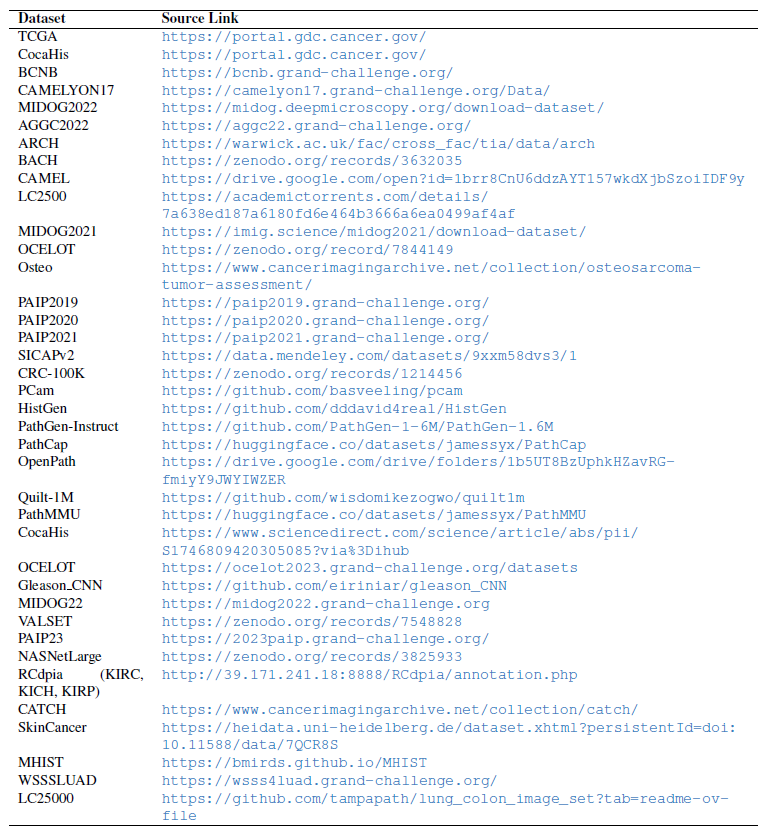

[上一级](README.md)

# 病理全切片（WSI）

WSI 是 MIL 的应用场景，不是 MIL 的全部。常见设定是以一张切片为包、组织 patch 为实例；患者可有多张切片，按切片随机划分可能造成患者泄漏。比较方法时还要固定倍率、组织筛选、patch 大小、特征提取器与标签来源。

## 1 常用 WSI MIL 基准

下表是常见且有清晰官方入口的起点，**不按使用频次排序**；同一资源的不同论文可能采用完全不同的任务和划分。

|数据集|官方入口|常见 MIL 任务与使用提醒|
|:---|:---|:---|
|CAMELYON16|[挑战赛数据页](https://camelyon16.grand-challenge.org/Data/)|淋巴结转移的切片级分类/定位；官方共 400 张 WSI，训练 270、测试 130。训练集的部分阳性切片提供区域标注；做弱监督 MIL 时须声明是否使用这些标注。|
|CAMELYON17|[挑战赛数据页](https://camelyon17.grand-challenge.org/Data/)|多中心淋巴结切片及患者级病理分期，适合检查中心间泛化与患者级划分。|
|TCGA 多癌种|[NCI GDC Portal](https://gdc.cancer.gov/access-data/gdc-data-portal)|可按 TCGA-LUAD/LUSC、BRCA、COAD/READ 等项目构建癌种、分型、分子状态或预后任务；不是一个统一的“TCGA 肺癌数据集”，需记录项目、病例筛选和标签定义。|
|PANDA|[官方挑战赛数据页](https://panda.grand-challenge.org/data/)|前列腺活检 WSI 的 Gleason/ISUP 分级；适合序数分级与多中心评估，需遵循数据许可。|
|BRACS|[数据集主页](https://www.bracs.icar.cnr.it/background/)|乳腺病理切片与 ROI 的癌前病变/癌症亚型分类；注意 WSI 和 ROI 两种粒度。|
|CPTAC 相关队列|[NCI 数据门户](https://proteomics.cancer.gov/data-portal)、[TCIA 病理影像索引](https://www.cancerimagingarchive.net/research/cptac-imaging-proteomics/)|可构建影像—蛋白组或预后任务；不同癌种影像及组学的可得性不一，必须核对病例匹配与授权。|

临床目标不只限于切片分类：[GAMINN](../Theories/13TaskAwareObjectives.md) 是以肺腺癌 WSI 预测复发风险与治疗反应的例子；生存终点、删失处理与外部队列应与分类任务分别评估。

原有清单中还有专项数据资源，保留其入口，但不把它们都称作通用 WSI MIL 分类基准：

|资源|入口|与通用 WSI MIL 的关系|
|:---|:---|:---|
|AGGC2022|[挑战赛](https://aggc22.grand-challenge.org/AGGC22/)|前列腺癌 Gleason 分级专项；核对其像素级/区域级标注的允许用途。|
|ARCH|[Warwick 数据页](https://warwick.ac.uk/fac/cross_fac/tia/data/arch/)|病理图像与文本资源，适合多模态研究，不是单纯 WSI 分类基准。|
|BACH|[Zenodo 原始发布](https://zenodo.org/records/3632035)|乳腺病理组织学图像数据；使用 WSI 子集时需说明所选文件与标签。|
|BCNB|[挑战赛](https://bcnb.grand-challenge.org/)|乳腺病理及临床结局相关任务；明确具体任务和可访问部分。|
|LC25000|[数据入口](https://academictorrents.com/details/7a638ed187a6180fd6e464b3666a6ea0499af4af)|肺/结肠组织图像，**非原生 WSI 包**，不直接作为 WSI MIL 标准基准。|
|MIDOG2022|[挑战赛](https://midog.deepmicroscopy.org/download-dataset/)|有丝分裂检测专项，不应直接与切片级分类数据混排。|
|Osteo|[TCIA](https://www.cancerimagingarchive.net/collection/osteosarcoma-tumor-assessment/)|骨肉瘤治疗反应评估资源；需先核对影像单位及可用标签。|

更多的下载方式可以参照 (图片来源于CPath-Omni)：

  

- **注1**：DSMIL 提供了某些任务的预处理版本，但应核对其与原始数据的筛选和划分差异；
- **注2**：数据集的预处理一般可以使用[**CLAM**](https://github.com/mahmoodlab/CLAM)；
- **注3**：早期表格里的类别数、类别平衡及“实例标签”会随任务和版本变化，故不在总览中写成固定属性；具体信息请参照下载后的版本。

## 2 原清单中的特征编码器记录

下表仅整理原仓库记录过的编码器组合，**不是统一对比实验**；论文可能还报告其他编码器或不同预训练权重。重新实验时应核对论文和公开代码的版本。

|方法|ResNet18 (512)|ViT-small (384)|ResNet50 (1024)|CTransPath|
|:---|:---:|:---:|:---:|:---:|
|CaMIL (AAAI'24)|√|√|||
|CIMIL (AAAI'24)|||√||
|VINO (AAAI'24)|√||||
|PAMIL (CVPR'24)|||√||
|WiKG (CVPR'24)||√|||
|IBMIL (CVPR'23)|√|√||√|
|CSMIL|||√||
|AdvMIL|||√||
|ProDiv|||√||

括号中为原记录的 patch 特征维度；其实际维度也取决于模型和特征提取层。
